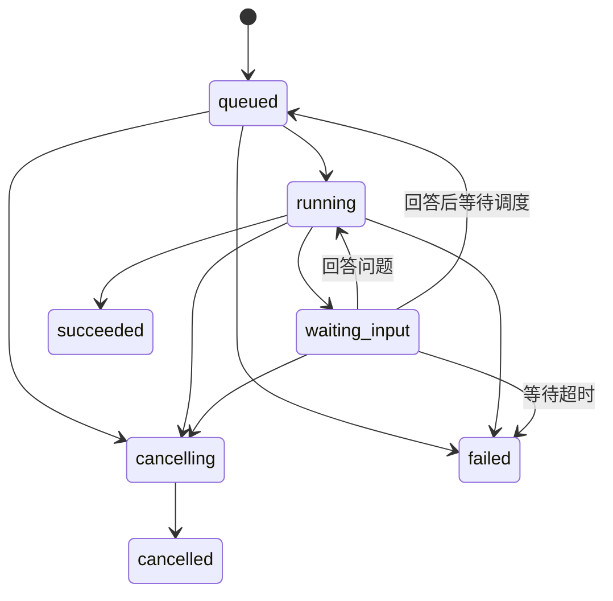

# 一句话生成视频：前后端接口文档

版本：v0.1 设计稿 · 日期：2026-11-13 · 前端：Vue · 后端：Rust

本文是根据业务流程制定的接口约定，供开发和联调使用。当前已实现使用本地演示数据的 Vue 前端，并提供 HTTP 调用适配；真实 Rust 接口尚未实现。登录方式、生成供应商、可选音色和导出规格接入时再与实际能力对齐，示例 ID 均为占位业务 ID。

## 1. 产品流程与接口边界

用户输入一句话，例如：“帮我做一个 30 秒的咖啡店宣传视频，温暖治愈一点。”系统补齐非必要参数，依次完成需求整理、文案与分镜、素材准备、配音与背景音乐、剪辑、调色与特效、预览渲染。用户查看结果后，可以继续说“第二个镜头换成咖啡特写”“语速慢一点”，再生成新版本。

| 业务环节   | 后端责任                               | 前端展示                   |
| ---------- | -------------------------------------- | -------------------------- |
| 选题       | 识别主题、风格、受众、目的，补齐默认值 | 一张简洁的创作方案卡片     |
| 文案与分镜 | 生成解说、镜头内容、景别、运镜和时长   | 可展开的脚本与分镜列表     |
| 素材准备   | 使用上传素材、素材库或生成模型         | 素材缩略图、来源、准备状态 |
| 音频       | 生成 TTS、匹配背景音乐、控制混音       | 音色、试听、音量设置       |
| 剪辑       | 编排镜头、字幕、转场、音画同步         | 制作进度、预览结果         |
| 调色与特效 | 应用用户选择的预设                     | 少量容易理解的预设选项     |
| 输出       | 渲染预览、生成版本、按需导出           | 播放器、版本切换、下载     |

前端只调用 Rust 业务接口。模型、素材库、TTS 和剪辑库都由后端调用；截图中的 llm1/llm2 等编号不进入前端接口。Vue 关闭、刷新或者网络断开，都不应终止后端任务。

第一版默认自动完成整个流程，不强制用户逐步确认。只有无法继续执行的关键信息缺失时才提问。调色与特效默认使用
`natural`、`none`，用户可以主动修改。

## 2. 基础约定

- 基础路径：`/api/v1`。下文接口路径均省略这个前缀。
- JSON 使用 `snake_case`；ID 是不透明字符串，前端不能根据格式推导含义。
- 时间使用 UTC RFC 3339；成片、镜头和素材时长使用整数毫秒
  `duration_ms`。用户输入的目标时长单独命名为 `target_duration_seconds`。
- JSON 请求使用 `Content-Type: application/json`，文件上传使用 `multipart/form-data`。
- 普通请求及事件流统一使用
  `Authorization: Bearer <access_token>`。鉴权签发复用项目实际登录模块，本文不另行设计登录接口。
- Rust 必须校验项目、素材、任务、视频版本属于当前用户；只知道 ID 不能获得访问权限。
- 普通成功响应使用 `data` 和 `request_id`；删除返回 HTTP 204，不返回 JSON。

成功示例：

```json
{
  "data": { "project_id": "prj_001" },
  "request_id": "req_001"
}
```

失败示例：

```json
{
  "error": {
    "code": "PROJECT_BUSY",
    "message": "当前视频正在制作，请完成或停止后再修改。",
    "retryable": false,
    "details": { "active_job_id": "job_001" }
  },
  "request_id": "req_002"
}
```

HTTP 状态：201 创建完成；202 异步任务已受理；400 请求结构错误；401 未登录；403 无权限；404 资源不存在；409 状态或版本冲突；410 事件游标过期；413 文件过大；415 文件类型不支持；422 参数或素材内容不合法；429 频率或配额限制；500 服务内部错误；503 服务暂时不可用。跨用户访问统一返回 404，避免泄露资源是否存在。

### 2.1 防重复与版本控制

- 创建项目、发送消息、上传文件、提交回答、重试任务和导出请求必须带
  `Idempotency-Key`，值由前端生成。相同用户、方法、路径和 key 在 24 小时内只执行一次；相同 key 携带不同内容返回
  `409 IDEMPOTENCY_CONFLICT`。响应丢失后使用原 key 重发，主动重新生成才使用新 key。
- 受理记录、用户消息、待回复消息与任务应在同一事务落库，后端提交后再异步执行。重发不能出现多条用户消息或重复生成。
- `draft_revision`
  是项目草稿版本，从 1 开始。用户修改草稿，或后端保存新的阶段产物时递增；普通聊天文本和进度变化不递增。
- 发送消息和修改草稿带 `expected_draft_revision`；不一致返回
  `409 REVISION_CONFLICT`，并带当前版本。前端重新取快照后，让用户保留并重新提交自己的修改。
- 每个项目最多一个活动任务，活动状态包括
  `queued/running/waiting_input/cancelling`。活动期间禁止修改草稿和启动其他任务，返回
  `409 PROJECT_BUSY`；允许查询、播放旧版本、回答当前问题和取消。此限制也适用于聊天任务和导出任务。

## 3. 核心数据对象

### 3.1 Project / Draft

一个项目同时是一段对话和一部视频的工作空间。一个项目可以产生多个成片版本。

| Project 字段                | 类型           | 含义                                                  |
| --------------------------- | -------------- | ----------------------------------------------------- |
| `id` / `title`              | string         | 项目 ID / 标题                                        |
| `status`                    | enum           | `draft / processing / waiting_input / ready / failed` |
| `draft_revision`            | integer        | 当前草稿版本                                          |
| `active_job_id`             | string 或 null | 当前活动任务                                          |
| `latest_video_version_id`   | string 或 null | 最近成功生成的成片版本                                |
| `draft_dirty`               | boolean        | 当前草稿是否尚未生成匹配的成片                        |
| `created_at` / `updated_at` | string         | 创建 / 最近变更时间                                   |

`status` 是页面摘要：有活动任务时为 `processing` 或 `waiting_input`；最近一次生成失败时为
`failed`，旧成片仍可播放；无活动任务且有成片为 `ready`，否则为
`draft`。取消或导出失败不改变已有成片。是否需要更新成片看 `draft_dirty`，不能仅看 `ready`。

Draft 包含：

| 字段                 | 含义                                   |
| -------------------- | -------------------------------------- |
| `brief`              | 主题、受众、目的、内容风格，由后端整理 |
| `settings`           | 目标时长、比例、语言、风格             |
| `script`             | `title` 和完整 `text`                  |
| `shots`              | 分镜数组，按数组顺序播放               |
| `audio`              | 配音音色、语速、背景音乐、音量         |
| `finishing`          | 调色预设、特效预设、字幕开关           |
| `invalidated_stages` | 需要重新计算的阶段，由后端返回         |

Shot 字段：`id`、`duration_ms`、`narration`、`visual_prompt`、`shot_size`、`camera_motion`、`asset_ids`。旁白可为空；无素材时
`asset_ids` 为 `[]`。景别、运镜是可读字符串；第一版由后端生成，前端无需枚举所有专业术语。

### 3.2 Message

字段：`id`、`project_id`、`role`（`user / assistant`）、`text`、`status`（`pending / streaming / completed / failed / cancelled`）、`asset_ids`、`job_id`、`blocks`、`last_delta_seq`、`created_at`。用户消息受理后即为
`completed`，其 job_id 可为空、last_delta_seq 为 0。

`blocks` 用于展示结构化结果，不让前端从 AI 自然语言里解析业务状态：

| `type`     | 必需字段                    | 页面用途                                 |
| ---------- | --------------------------- | ---------------------------------------- |
| `plan`     | `summary`、`draft_revision` | 创作方案摘要                             |
| `progress` | `job_id`                    | 制作步骤卡片                             |
| `question` | `job_id`、`question_id`     | 需要用户补充信息                         |
| `script`   | `draft_revision`            | 打开当前脚本；历史脚本以成片版本快照为准 |
| `video`    | `video_version_id`          | 成片卡片                                 |
| `error`    | `job_id`、`code`、`message` | 失败说明与可用操作                       |

消息只返回面向用户的说明，不返回模型内部推理或供应商密钥。

### 3.3 Job

| 字段                                | 含义                                                                             |
| ----------------------------------- | -------------------------------------------------------------------------------- |
| `id` / `project_id`                 | 任务 / 所属项目                                                                  |
| `parent_job_id`                     | 重试来源任务 ID；非重试为 null                                                   |
| `kind`                              | `generate / revise / chat / export`                                              |
| `status`                            | `queued / running / waiting_input / cancelling / succeeded / failed / cancelled` |
| `current_stage`                     | 当前阶段；排队和普通聊天可为 null                                                |
| `progress_percent`                  | 0～100 或 null；是估算值，无可靠估算时返回 null                                  |
| `stages`                            | 阶段数组：`key/status/progress_percent/message`                                  |
| `question`                          | 当前待回答问题或 null，结构见 5.6                                                |
| `result`                            | 未完成时为 null；完成结构见下文                                                  |
| `error`                             | 未失败时为 null；失败时含 `code/message/retryable/failed_stage`                  |
| `created_at/started_at/finished_at` | 任务时间；未开始、未结束的字段为 null                                            |

阶段 key：`planning / script / storyboard / visuals / audio / edit / finishing / render`。阶段状态：`pending / running / succeeded / failed / skipped / cancelled`。素材和音频允许并行，剪辑等待两者完成；前端按阶段集合渲染，不假设只会有一个运行中的阶段。`chat`
任务不运行制作阶段，`export` 任务仅使用 `render` 阶段。

成功结果采用区分类型的结构：

- generate / revise：`{"video_version_id":"ver_001","draft_revision":8}`。
- chat：`{"assistant_message_id":"msg_002"}`。
- export：`{"asset_id":"ast_export_001","video_version_id":"ver_001"}`。

任务状态转换：



`succeeded/failed/cancelled` 为终态。停止是否成功由后端事务判定：进入 `cancelling`
后不得再发布成片；如果成功提交先于取消请求，取消返回 409，保留成功状态。

### 3.4 Asset / VideoVersion

Asset 字段：`id/project_id/kind/source/status/file_name/mime_type/size_bytes/duration_ms/width/height/thumbnail_url/error`。

- `kind`：`image / video / audio`；`source`：`upload / library / generated / rendered`。
- `status`：`processing / ready / failed`。不适用的宽高、时长和缩略图为 null。
- `error`：正常时为 null，解析失败时为 `code/message`。
- 缩略图为临时地址，和预览 URL 一样通过重新查询刷新。

VideoVersion 字段：`id/project_id/version_number/source_draft_revision/source_job_id/created_at/video_asset_id/thumbnail_url/duration_ms/width/height/playback_url/url_expires_at/snapshot/exports`。

每次 generate/revise 成功创建一个不可变版本。`snapshot` 保存当次完整 Draft；`exports`
是导出列表，每项包含
`asset_id/resolution/fps/format/created_at`。导出不创建新的内容版本。修改草稿不会覆盖旧成片；只有新成片成功发布才更新
`latest_video_version_id`。

## 4. 接口总览

| 方法   | 路径                                                   | 作用                         |
| ------ | ------------------------------------------------------ | ---------------------------- |
| GET    | `/capabilities`                                        | 可用参数、默认值、上传限制   |
| POST   | `/projects`                                            | 创建空项目 / 新对话          |
| GET    | `/projects`                                            | 左侧历史项目列表             |
| GET    | `/projects/{project_id}`                               | 完整工作台快照及恢复游标     |
| PATCH  | `/projects/{project_id}`                               | 修改项目标题                 |
| DELETE | `/projects/{project_id}`                               | 删除无活动任务的项目         |
| POST   | `/projects/{project_id}/messages`                      | 发起生成、对话修改或普通问答 |
| GET    | `/projects/{project_id}/messages`                      | 分页加载更早的消息           |
| PATCH  | `/projects/{project_id}/draft`                         | 保存脚本、分镜和参数修改     |
| POST   | `/projects/{project_id}/assets`                        | 上传素材                     |
| GET    | `/projects/{project_id}/assets`                        | 素材列表                     |
| GET    | `/assets/{asset_id}`                                   | 查询素材处理状态             |
| GET    | `/assets/{asset_id}/download`                          | 获取短期下载链接             |
| GET    | `/jobs/{job_id}`                                       | 查询完整任务状态             |
| POST   | `/jobs/{job_id}/answers`                               | 回答任务追问并继续           |
| POST   | `/jobs/{job_id}/cancel`                                | 请求停止任务                 |
| POST   | `/jobs/{job_id}/retry`                                 | 失败或取消后创建重试任务     |
| GET    | `/projects/{project_id}/events`                        | SSE：文本增量与制作进度      |
| GET    | `/projects/{project_id}/versions`                      | 成片版本列表                 |
| GET    | `/projects/{project_id}/versions/{version_id}`         | 版本详情、播放地址、历史草稿 |
| POST   | `/projects/{project_id}/versions/{version_id}/exports` | 导出指定成片                 |

## 5. 接口详情

### 5.1 获取能力与默认参数

`GET /capabilities` → 200。

```json
{
  "data": {
    "defaults": {
      "target_duration_seconds": 30,
      "aspect_ratio": "9:16",
      "language": "zh-CN",
      "style_id": "warm",
      "voice_id": "voice_zh_warm",
      "music_mode": "auto",
      "color_preset_id": "natural",
      "effect_preset_id": "none",
      "subtitles_enabled": true
    },
    "duration_range_seconds": { "min": 5, "max": 120 },
    "aspect_ratios": ["9:16", "16:9", "1:1"],
    "languages": ["zh-CN"],
    "styles": [{ "id": "warm", "name": "温暖治愈" }],
    "voices": [{ "id": "voice_zh_warm", "name": "温柔女声", "sample_url": null }],
    "music_tracks": [{ "id": "bgm_light", "name": "轻松日常", "sample_url": null }],
    "color_presets": [{ "id": "natural", "name": "自然" }],
    "effect_presets": [{ "id": "none", "name": "无额外特效" }],
    "exports": {
      "formats": ["mp4"],
      "resolutions": ["720p", "1080p"],
      "fps": [30],
      "preview_resolution": "720p"
    },
    "upload_limits": {
      "max_uploaded_files_per_project": 20,
      "image": { "max_bytes": 20971520, "mime_types": ["image/jpeg", "image/png", "image/webp"] },
      "video": { "max_bytes": 104857600, "mime_types": ["video/mp4", "video/webm"] },
      "audio": { "max_bytes": 52428800, "mime_types": ["audio/mpeg", "audio/wav"] }
    },
    "event_retention_seconds": 86400
  },
  "request_id": "req_003"
}
```

上面的范围是首版拟定值，不代表现有供应商支持情况。后端只能返回已经接通的能力；前端不能把示例中的风格、音色、分辨率写死。分辨率指短边：720p 竖屏为 720×1280，横屏为 1280×720，方形为 720×720。

### 5.2 创建、查询和管理项目

`POST /projects`，带幂等 key → 201。请求：

```json
{
  "title": "新的创作"
}
```

`title` 可省略，默认“新的创作”，长度 1～100。返回 `data.project`，其中
`draft_revision=1`、`active_job_id=null`、`latest_video_version_id=null`、`draft_dirty=true`。后端按 capabilities 初始化 Draft；创建本身不调用模型。第一次消息可自动生成更合适的标题。

`GET /projects?cursor=<opaque>&limit=20` → 200，返回 `data.items: Project[]`、`data.next_cursor`；按
`updated_at DESC, id DESC` 排序。默认 20、最大 100，首次不传 cursor，末页为 null。

`GET /projects/{project_id}` → 200，返回同一数据库一致性快照：

```json
{
  "data": {
    "project": {
      "id": "prj_001",
      "title": "咖啡店宣传视频",
      "status": "draft",
      "draft_revision": 1,
      "active_job_id": null,
      "latest_video_version_id": null,
      "draft_dirty": true,
      "created_at": "2026-11-13T09:00:00Z",
      "updated_at": "2026-11-13T09:00:00Z"
    },
    "draft": {
      "brief": null,
      "settings": {
        "target_duration_seconds": 30,
        "aspect_ratio": "9:16",
        "language": "zh-CN",
        "style_id": "warm"
      },
      "script": null,
      "shots": [],
      "audio": {
        "voice_id": "voice_zh_warm",
        "speech_rate": 1.0,
        "music_mode": "auto",
        "music_id": null,
        "music_asset_id": null,
        "resolved_music_asset_id": null,
        "narration_volume": 1.0,
        "music_volume": 0.2
      },
      "finishing": {
        "color_preset_id": "natural",
        "effect_preset_id": "none",
        "subtitles_enabled": true
      },
      "invalidated_stages": [
        "planning",
        "script",
        "storyboard",
        "visuals",
        "audio",
        "edit",
        "finishing",
        "render"
      ]
    },
    "active_job": null,
    "latest_video": null,
    "messages_page": { "items": [], "next_cursor": null },
    "event_cursor": "0"
  },
  "request_id": "req_004"
}
```

`active_job` 为 Job 或 null；`latest_video` 为 VideoVersion 或 null。`messages_page`
为最近 50 条 Message，按时间正序返回；其 `next_cursor`
用来加载更早消息。快照包括事件游标，供刷新后无缝恢复。

`PATCH /projects/{project_id}` 请求 `{"title":"周末咖啡店宣传片"}` → 200，返回
`data.project`。只改标题不增加草稿版本，允许生成期间改名。

`DELETE /projects/{project_id}` →
204。活动任务存在时返回 409，先停止并等任务终态。项目立即从用户视图移除，后台清理关联文件；已签发的临时链接最迟在有效期结束后失效。前端在删除前给出一次明确的项目删除确认。

### 5.3 发送消息：唯一的创作入口

`POST /projects/{project_id}/messages`，带幂等 key → 202。

```json
{
  "intent": "generate",
  "text": "帮我做一个30秒的咖啡店宣传视频，温暖治愈一点。",
  "asset_ids": [],
  "expected_draft_revision": 1,
  "base_video_version_id": null
}
```

| 字段                      | 必填        | 约束                                                          |
| ------------------------- | ----------- | ------------------------------------------------------------- |
| `intent`                  | 是          | `generate / revise / chat`，由界面当前模式确定                |
| `text`                    | 是          | 1～5000 字符；generate 在已有脚本时可以写“按当前脚本生成视频” |
| `asset_ids`               | 否          | 默认 []，必须属于本项目且均为 ready                           |
| `expected_draft_revision` | 是          | 必须等于当前草稿版本                                          |
| `base_video_version_id`   | revise 时是 | 必须为当前最新成功版本；其他 intent 为 null 或省略            |

- `generate`：根据当前草稿、消息和素材生成视频；首次使用的默认操作。
- `revise`：根据本条修改意见更新当前草稿，后端确定影响范围，复用有效产物后生成新版本。例如只换配音通常无需重生成镜头素材。
- `chat`：只回答问题，不生成、修改草稿或导出视频。界面提供可选“仅讨论”模式。
- 面板中未保存的参数先通过 5.4 保存，再使用返回的新 revision 发消息。消息中的新要求优先于已有草稿设置；同一次要求内部有明确冲突且无法判断时，后端只针对冲突追问。前端不调用分镜模型、TTS 或剪辑模型。
- 目标时长是生成目标，实际值以 VideoVersion 的 `duration_ms`
  为准；镜头长度和配音不匹配时由后端调整或返回明确失败原因。

响应：

```json
{
  "data": {
    "user_message_id": "msg_001",
    "assistant_message_id": "msg_002",
    "job_id": "job_001",
    "job_status": "queued"
  },
  "request_id": "req_005"
}
```

HTTP
202 表示已受理，不能显示“视频生成完成”。这两个消息 ID 已持久化；后续从消息列表或快照获得完整 Message。

`GET /projects/{project_id}/messages?cursor=<opaque>&limit=50` → 200，返回
`items: Message[] / next_cursor`。首次取最近一页，cursor 向更早翻页；每一页内部按时间正序，默认 50、最大 100。未知的 block 类型显示通用结果卡片，不让页面报错。

### 5.4 保存脚本、分镜与设置

`PATCH /projects/{project_id}/draft` → 200。示例：

```json
{
  "expected_draft_revision": 8,
  "changes": {
    "audio": {
      "voice_id": "voice_zh_warm",
      "speech_rate": 0.9,
      "music_mode": "library",
      "music_id": "bgm_light",
      "music_asset_id": null,
      "narration_volume": 1.0,
      "music_volume": 0.15
    },
    "finishing": {
      "color_preset_id": "natural",
      "effect_preset_id": "none",
      "subtitles_enabled": true
    }
  }
}
```

`changes` 允许
`settings/script/shots/audio/finishing`，不允许修改 brief、资源归属或版本 ID。提交的每个顶层子对象整体替换，未提交的顶层字段保持原值；因此提交 audio 时必须带齐 audio 的可写字段，避免不同客户端对深层合并规则理解不一致。必需字段缺失返回 422。

- `settings`：结构见快照；时长范围、比例、语言和风格由 capabilities 校验。
- `script`：完整的
  `{"title":"标题","text":"完整解说词"}`；非空，title 最多 100 字符、text 最多 20000 字符。
- `shots`：完整数组，1～100 个镜头，每项字段见 3.1，`duration_ms>0`；修改现有镜头保留 ID，新增镜头省略 ID，由后端分配。数组顺序即播放顺序，重复、陌生 ID 和非本项目素材返回 422。
- `audio`：语速范围拟定 0.5～2.0；两个音量均为 0～1。`music_mode` 为
  `auto / none / library / upload`：auto 由后端匹配，none 不配音乐，library 必须带有效 music_id，upload 必须带本项目 ready 的音频 music_asset_id。auto/none 的两个来源 ID 均为 null；library 的 music_asset_id 为 null，upload 的 music_id 为 null。只读字段
  `resolved_music_asset_id`
  由后端在音频准备完成时填入，指向最终使用的音乐素材，none 为 null；客户端不得提交此字段。音频设置改变时清空旧解析结果，成片快照保存实际素材用于复现。
- `finishing`：结构见快照，预设 ID 必须来自 capabilities。
- 脚本文本变更会让旧分镜、素材匹配、配音及后续合成失效；分镜旁白变更时后端同步重建 `script.text`
  并使相关配音失效。避免两份文本相互覆盖，同一个请求不允许同时提交 `script` 和 `shots`。
- 画面变更至少使对应素材与后续合成失效；音频变更使音频与后续合成失效；调色和特效变更使 finishing/render 失效。实际依赖和可复用范围由后端计算。

返回 `data.draft_revision / data.draft / data.draft_dirty`。Draft 的 `invalidated_stages`
明确需要更新的阶段。保存只更新草稿，界面显示“修改已保存，生成后生效”；点击“更新视频”再走 messages 接口，不能把旧成片假装成已更新。

### 5.5 上传与获取素材

`POST /projects/{project_id}/assets`，带幂等 key，multipart 字段 `file`，一次一个文件 → 201，返回
`data.asset: Asset`。视频或音频元数据尚未解析时，Asset.status 为 processing；已解析为 ready。文件校验失败可以同步返回 413/415/422，异步解析失败则 Asset.status 为 failed。

`GET /projects/{project_id}/assets?cursor=<opaque>&limit=50` → 200，返回
`data.items: Asset[] / data.next_cursor`，按创建时间倒序，默认 50、最大 100。

`GET /assets/{asset_id}` → 200，返回
`data.asset`。前端对 processing 素材每 2 秒查询一次，离开页面停止查询。生成请求必须等待所选素材全部 ready，否则返回
`409 ASSET_NOT_READY` 和未就绪的 asset_ids。

后端按 capabilities 校验数量、文件体积与实际媒体类型，并解析真实时长、宽高；不能只相信文件扩展名和客户端 MIME。超出时长、损坏或解码失败返回可读原因。前端上传进度与视频生成进度分别展示。

素材在项目内统一存储，输入消息和分镜用 asset_id 引用。页面移除一个待发送附件只改变本次选择，不删除已经被历史版本引用的素材。第一版无需单独的永久删除素材接口，统一随项目清理。

### 5.6 查询任务与回答追问

`GET /jobs/{job_id}` → 200，返回 `data.job: Job`。失败结果通过 Job.error 表达；HTTP
200 表示查询成功，不代表任务成功。

无法继续制作时进入 waiting_input，Job.question 示例：

```json
{
  "id": "question_001",
  "prompt": "你希望宣传的店名是什么？也可以选择不展示店名。",
  "input_type": "text",
  "options": [],
  "expires_at": "2026-11-14T09:05:00Z"
}
```

`input_type` 为 text 或 single_select；后者 options 为 `[{"value":"no_name","label":"不展示店名"}]`
这样的数组。一次最多一个问题。一般偏好应使用默认值，不逐项向小白追问。

`POST /jobs/{job_id}/answers`，带幂等 key → 202：

```json
{
  "question_id": "question_001",
  "value": "暖日咖啡"
}
```

返回
`data.job_id / data.job_status`。回答恢复同一任务，状态为 running 或 queued，不创建第二次生成。后端原子校验 question_id；过期、已回答、状态不符返回
`409 QUESTION_NOT_ACTIVE`。等待超过 expires_at 进入 failed，错误码
`INPUT_TIMEOUT`，不无限占用执行线程。

### 5.7 停止与重试

`POST /jobs/{job_id}/cancel`，无需 body
→ 活动任务返回 202，`data.job_id / data.job_status=cancelling`；重复取消 cancelling 仍返回 202，已 cancelled 返回 200。已 succeeded/failed 返回
`409 JOB_ALREADY_FINISHED`。

取消是尽力停止外部调用，前端先显示“正在停止”。后端须阻止取消后的迟到结果发布，并最终把任务置为 cancelled；已经成功提交的旧版本继续保留。

`POST /jobs/{job_id}/retry`，带幂等 key → 202：

```json
{
  "expected_draft_revision": 6
}
```

仅允许 failed 且 error.retryable=true，或 cancelled 的任务。返回
`data.job_id / data.parent_job_id / data.job_status`，创建新任务，不复用旧任务 ID、不重复插入原用户消息；为新任务创建新的 assistant 消息，错误卡片关联 parent_job_id。

重试使用原任务保存的输入及有效检查点，从最早失效阶段继续。当前草稿必须与原任务最后保存的 revision 一致，否则返回
`409 RETRY_INPUT_CHANGED`，请用户根据当前草稿重新发送生成请求。后端不能信任前端提交“跳过某阶段”。对于 export，重试保留原 version_id 和导出规格。

### 5.8 成片版本、导出与下载

`GET /projects/{project_id}/versions?cursor=<opaque>&limit=20` → 200，返回
`data.items: VideoVersion[] / data.next_cursor`，按 version_number 倒序；列表项省略 snapshot、playback_url、url_expires_at 和 exports，保留元信息和缩略图。默认 20、最大 100。

`GET /projects/{project_id}/versions/{version_id}` → 200，返回
`data.version: VideoVersion`，包括可播放地址和该版本的完整脚本、分镜及设置快照。切换历史版本仅改变查看对象，不把历史草稿自动写回当前项目。

`POST /projects/{project_id}/versions/{version_id}/exports`，带幂等 key → 202：

```json
{
  "format": "mp4",
  "resolution": "1080p",
  "fps": 30
}
```

返回
`data.job_id / data.job_status`。导出严格使用指定成片的不可变快照，不读取后来编辑的 Draft。生成阶段默认已有可下载的预览文件；导出用于其他输出规格。若同一版本已有相同规格的成功文件，直接返回 200 和
`data.asset_id / data.cached=true`，无需重新渲染。异步成功通过 Job.result.asset_id 获取文件。

`GET /assets/{asset_id}/download` → 200：

```json
{
  "data": {
    "asset_id": "ast_export_001",
    "file_name": "咖啡店宣传片-v1.mp4",
    "mime_type": "video/mp4",
    "size_bytes": 12582912,
    "download_url": "/media/download/ast_export_001?signature=example",
    "expires_at": "2026-11-13T09:35:00Z"
  },
  "request_id": "req_006"
}
```

下载、播放 URL 有效期拟定 5 分钟，以实际 expires_at/url_expires_at 为准。播放过期重新取 version，下载过期重新取 download。地址可以是后端媒体代理或对象存储签名 URL，不暴露供应商密钥和服务器文件路径。播放器资源应支持 Range 请求；下载文件应设置 Content-Disposition。

## 6. SSE：聊天文本与制作进度

`GET /projects/{project_id}/events?after=<event_cursor>`，请求
`Accept: text/event-stream`。鉴权和普通请求相同。前端使用支持 Authorization 的 fetch 流读取 SSE；原生 EventSource 的构造参数不提供自定义 Authorization
header，因此本方案不直接依赖它，也不把 token 放进 URL。

响应头：`Content-Type: text/event-stream; charset=utf-8`、`Cache-Control: no-cache`。服务端和代理关闭缓冲，约每 15 秒发送一次
`: ping` 注释；心跳不分配事件 ID。

```text
id: 105
event: job.updated
data: {"project_id":"prj_001","job_id":"job_001","status":"running","current_stage":"visuals","progress_percent":42,"message":"正在准备第2个镜头的画面"}

id: 106
event: message.delta
data: {"message_id":"msg_002","delta_seq":3,"text_delta":"正在为你准备温暖的咖啡店画面。"}

id: 107
event: draft.updated
data: {"project_id":"prj_001","draft_revision":6}

id: 108
event: video.created
data: {"project_id":"prj_001","job_id":"job_001","video_version_id":"ver_001"}

```

每个事件以空行结尾，data 是单行 JSON。分块读取时，一个网络块可能只有半条事件，也可能含多条事件；前端使用 SSE 解析器或保留未完成缓冲，不能直接对每个网络块 JSON.parse。

| 事件                | data 必需内容                                                        | 前端行为                             |
| ------------------- | -------------------------------------------------------------------- | ------------------------------------ |
| `message.created`   | message_id                                                           | 按 ID 获取快照中的新消息             |
| `message.delta`     | message_id、delta_seq、text_delta                                    | 流式追加可见文本                     |
| `message.completed` | message_id                                                           | 刷新消息，完整 text 覆盖临时拼接文本 |
| `job.updated`       | project_id、job_id、status、current_stage、progress_percent、message | 更新任务摘要；需要阶段详情时查询 Job |
| `input.required`    | job_id、question_id                                                  | 查询 Job，展示问题卡片               |
| `draft.updated`     | project_id、draft_revision                                           | 查询项目快照，更新右侧草稿           |
| `video.created`     | project_id、job_id、video_version_id                                 | 查询版本，展示播放器                 |
| `job.completed`     | job_id                                                               | 查询 Job 与项目快照，释放忙碌状态    |
| `job.failed`        | job_id、code、message、retryable                                     | 查询 Job，展示失败和可用操作         |
| `job.cancelled`     | job_id                                                               | 查询快照，显示已停止                 |

恢复与一致性约定：

1. 进入项目先 GET 项目快照，再用返回的 event_cursor 连接事件流。after 为排他游标，只补发之后的事件；初始项目游标为
   `"0"`。
2. 事件 ID 是项目内单调递增的十进制字符串；前端按原字符串去重，不转为 JavaScript
   Number。状态变更和对应事件在同一事务提交，进程重启后仍能重放。
3. 事件至少保留 capabilities 中的 event_retention_seconds。游标不属于项目或位于未来返回 400；历史游标已被清理返回
   `410 EVENT_CURSOR_EXPIRED`。前端重新取快照，从新游标继续。
4. fetch 流的重连需要前端自行实现，建议 1/2/4/8 秒退避，上限 15 秒；携带最后已应用的 after，不能通过重新 POST 消息恢复。`message.delta`
   同时按 delta_seq 去重。
5. 原生 Last-Event-ID 和 after 均可由服务端支持；本 Vue 方案统一传 after，二者同时存在且不一致时返回 400。首次未带游标时返回 400，避免连接与取快照间漏事件。
6. 项目快照里的消息 text 是已经持久化的完整当前文本；每个 Message 额外包含
   `last_delta_seq`（初始 0）。从快照恢复时同步这个值，防止对已包含的增量重复追加。
7. 网络关闭不等于任务失败或取消。多次重连失败时退化为每 3 秒查询项目快照；重新建立连接前刷新快照。页面离开后停止本地监听和轮询。
8. 收到终态先关闭本轮连接，再获取最终快照，避免“先取新快照、后收到旧事件”造成回退。其他需要刷新快照的事件也使用“关闭流→读快照→从新游标重连”；串行执行并合并重复刷新请求。最终业务结果以持久化快照为准。
9. 订阅时和连接期间都要校验鉴权；登录过期时关闭流，前端续期后按游标重连。项目删除后关闭连接，后续查询返回 404。

SSE 的事件格式和 Last-Event-ID 依据
[WHATWG Server-sent events](https://html.spec.whatwg.org/dev/server-sent-events.html)；游标保留、持久化和退避上限是本项目约定。

## 7. 错误与界面处理

| 错误码                  | 常见触发                     | 界面处理                                        |
| ----------------------- | ---------------------------- | ----------------------------------------------- |
| `VALIDATION_ERROR`      | 参数、枚举值或媒体内容不合法 | 标记具体字段；details.fields 返回字段路径与原因 |
| `PROJECT_BUSY`          | 同项目正在制作或停止         | 显示当前任务，不重复提交                        |
| `REVISION_CONFLICT`     | 多窗口或旧页面修改草稿       | 拉取最新草稿，保留本地输入待用户重试            |
| `IDEMPOTENCY_CONFLICT`  | 相同幂等 key 被用于不同请求  | 修正客户端 key 使用，不自动重发新任务           |
| `ASSET_NOT_READY`       | 素材仍在解析                 | 等待 ready 后允许发送                           |
| `BASE_VERSION_MISMATCH` | revise 使用的已不是最新成片  | 刷新最新版本，再确认修改对象                    |
| `QUESTION_NOT_ACTIVE`   | 问题失效、已回答或任务已停止 | 刷新任务；不要重复恢复生成                      |
| `RETRY_INPUT_CHANGED`   | 失败后草稿已经改变           | 改为基于当前草稿发起新任务                      |
| `JOB_NOT_RETRYABLE`     | 当前状态或错误不允许重试     | 展示原因，允许用户修改需求后重新生成            |
| `JOB_ALREADY_FINISHED`  | 取消时任务已完成             | 按最终结果更新界面                              |
| `QUOTA_EXCEEDED`        | 用户额度不足                 | 展示后端可读原因，不循环自动重试                |
| `PROVIDER_UNAVAILABLE`  | 外部模型或素材服务不可用     | 任务失败卡片提供重试                            |
| `RENDER_FAILED`         | 剪辑或编码失败               | 保留检查点和旧成片，提供重试                    |
| `INPUT_TIMEOUT`         | 待回答问题过期               | 解释原因，允许重新发起                          |
| `EVENT_CURSOR_EXPIRED`  | 断线过久                     | 静默重取快照并恢复                              |

普通 API 错误使用 error 对象；异步错误使用 Job.error，不能把 Rust
panic、堆栈或供应商原始报错直接展示给用户。429/503 可以返回 Retry-After；前端仅对幂等请求和查询执行受控重试。

## 8. Vue 调用顺序

首次创作：

1. GET capabilities，初始化页面选项与默认值。
2. 用户首次发送时 POST projects，得到 project_id；保留创建幂等 key，防止网络重试创建多个项目。
3. 有附件则逐个上传并等待 ready；有显式设置则 PATCH draft，拿到最新 draft_revision。
4. POST messages，intent=generate，拿到 job_id。
5. GET 项目快照，从 event_cursor 连接 SSE；开始显示已经持久化的消息与进度。
6. 若 waiting_input，提交 answers；若失败，按 retryable 决定是否显示重试。
7. 成功后 GET version 播放；用户可以直接下载预览文件，也可以选择导出规格。

继续修改：选中当前最新成片 → POST
messages，intent=revise，带最新 expected_draft_revision 和 base_video_version_id → 生成 v2
→ 保留 v1 可切换查看。

刷新恢复：GET 项目快照 → 恢复消息、草稿、活动任务和旧成片 → 从游标续接。前端不能因为刷新就自动再次发起生成。

## 9. Rust 实现与联调验收

Rust 框架不限定，业务层至少分为 HTTP 接口、持久化项目数据、后台任务编排、供应商适配、媒体渲染与文件访问。队列和执行状态须可恢复，不能仅在请求处理函数中启动一个无持久记录的临时任务。

阶段输入摘要、输出素材和检查点落库；每个任务的执行尝试持有独立 fencing
token，旧 worker、超时调用和取消后迟到的结果均不能覆盖新状态。服务重启后恢复未完成任务，或把无法恢复的任务标记为可重试失败，不能永久显示“制作中”。

首版联调应覆盖：一句话无素材生成；上传素材生成；只换某个镜头；只改配音；手动保存设置后再更新；waiting_input 回答；网络重发不重复生成；刷新恢复；事件游标过期；任务失败重试；输入变更阻止旧重试；取消与完成竞态；多窗口版本冲突；播放/下载地址过期；导出复用；跨用户资源隔离；生成失败后旧成片仍可播放。以上为待实现验收项，当前未执行真实后端测试。
