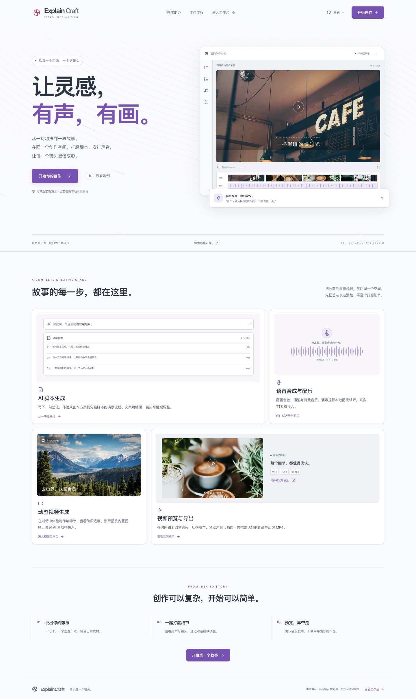

# ExplainCraft 前端与桌面工作台

`front/` 保存全部 Vue、TypeScript、样式、静态素材和前端测试。代码有两个独立入口：

| 入口          | 用途              | 开发命令             | 构建产物                  |
| ------------- | ----------------- | -------------------- | ------------------------- |
| `index.html`  | GitHub Pages 官网 | `npm run dev`        | `dist/website/index.html` |
| `studio.html` | Tauri 创作工作台  | `npm run dev:studio` | `dist/studio/studio.html` |

两种构建共享主题和少量工具，但不会把对方入口打进产物。官网只负责产品展示、示例播放和桌面版下载；
工作台通过 `src/services/api.ts` 使用 Rust 后端，桌面端不会因为存在浏览器演示适配而绕过内嵌服务。



## 桌面端

需要 Node.js 24.12+、Rust 和 Tauri 2 平台依赖。首次运行：

```bash
npm ci
npm run desktop:dev
```

根目录 `src-tauri/` 在同一个 crate 中提供 Rust commands，工作台通过 IPC 调用它们。
数据库和生成文件保存在应用数据目录，演示素材随应用打包，媒体文件通过 Tauri 自定义协议读取。

```bash
npm run desktop:build
```

Windows 的 quercus 版本使用：

```powershell
npm run desktop:dev:windows
npm run desktop:build:windows
```

这两个脚本要求 MSVC 和 FFmpeg 开发包，详见
[后端说明](../src-tauri/README.md)。普通 `desktop:*` 命令不启用 quercus，默认使用后端演示供应商。

## 官网

```bash
npm run dev
npm run build:website
npm run preview
```

浏览器打开 <http://127.0.0.1:5173>。所有“立即下载”链接均指向
<https://github.com/LDFei/Bohack-ExplainCraft/releases>。

GitHub Pages 工作流以 `VITE_BASE=/<仓库名>/` 构建并只上传 `dist/website/`。官网不包含
`studio.html`、接口适配或任何后端服务，线上访客必须下载桌面应用后使用工作台。

## 工作台功能

- 左侧素材与项目历史、中央画布和时间轴、右侧 AI Copilot；手机上按区切换。
- 一句话发起制作，逐阶段展示进度，支持停止、失败重试和回答追问后继续。
- 对话修改生成新版本；历史版本保留，脚本和设置以只读快照查看。
- 图片、视频、音频上传；文件类型、大小和可解码性由前后端共同校验。
- 脚本编辑、音色、语速、音乐、音量、字幕、风格和比例设置。
- 成片播放、MP4 导出下载、仅讨论模式、灵感模板、改名和删除。
- 可调整三栏布局、收起侧栏、切换四套主题并保存通用偏好。

后端默认 `demo` 供应商使用本地示例素材，界面会显示“后端演示”。配置真实模型供应商后，
同一工作台可以执行真实文案、画面、配音、配乐与渲染流程；供应商配置不属于前端环境变量。

## 浏览器开发适配

原有纯前端演示状态机保留在 `src/domain/engine.ts`，便于无 Rust 环境时测试工作台交互：

```bash
npm run dev:studio
```

打开 <http://127.0.0.1:5173/studio.html#/create>。这个模式只用于开发测试，不部署到官网。

浏览器工作台始终使用这个无后端演示模式，不能连接外部 Rust 服务。真实后端只随 Tauri
桌面应用启动，接口地址由桌面壳注入。接口细节见 [API 文档](docs/API.md)。

## 验证

所有 npm、uv 和 Playwright 命令都从 `front/` 执行：

```bash
npm run format
npm run format:check
npm test
npm run test:e2e
npm run build:website
npm run check:website
npm run build:studio
```

浏览器测试使用本机 Google Chrome，并自动启动开发服务。Rust workspace 检查从仓库根目录执行：

```bash
npm run build:studio
cargo fmt --all --check
cargo test --workspace
```

上面的 Cargo 命令从仓库根目录执行；`build:studio` 仍从 `front/`
执行。也可以只检查不需要前端产物的业务库：

```bash
cargo fmt --all --check
cargo test -p lingjing-desktop
```

第一次阅读源码可从 [代码阅读顺序](docs/CODE_GUIDE.md) 开始。布局、视觉评审与素材来源分别见
[工作台设置](docs/WORKSPACE_SETTINGS.md)、[视觉审查](docs/aceternity/VISUAL_REVIEW.md) 和
[素材来源](docs/MEDIA_SOURCES.md)。
