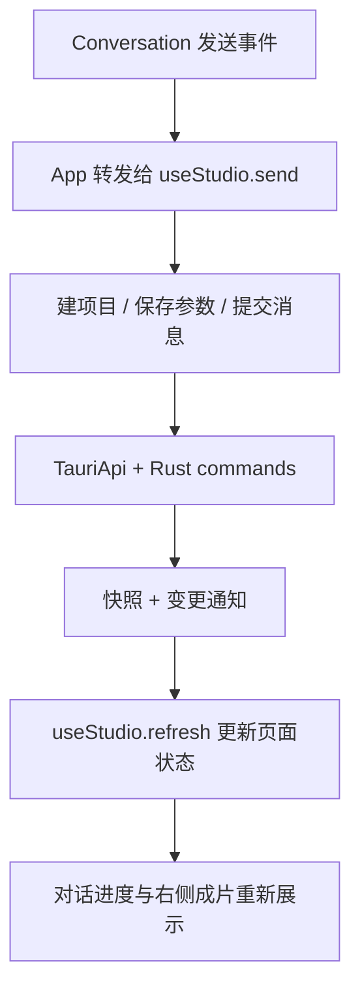

# 前端代码阅读顺序

这份说明配合源码中的中文注释使用。工作台只通过 `TauriApi`
连接 Rust commands；独立官网位于 `website/`。

## 先分清五种数据

| 名称         | 含义                                       | 容易混淆的地方                                  |
| ------------ | ------------------------------------------ | ----------------------------------------------- |
| Project      | 一次创作的工作空间，也是左侧的一条历史记录 | 项目不是一次任务，一个项目能生成多个版本        |
| Draft        | 当前可以编辑的脚本、分镜与设置             | 保存草稿不会立刻改变播放器里的成片              |
| Message      | 一条用户或助手消息                         | 助手消息还含结构化 blocks，不能只看文字判断完成 |
| Job          | 一次生成、讨论、修改或导出任务             | 接口受理成功不等于任务执行成功                  |
| VideoVersion | 一次成功生成的成片及当时的草稿快照         | 历史版本只读，不跟随后续草稿编辑变化            |

字段定义在 [types.ts](../src/domain/types.ts)。`asset_id`
是素材引用，文件内容另存；视频与镜头时长使用 `duration_ms`，目标时长单独使用
`target_duration_seconds`。

## 建议按这个顺序读

| 文件                                            | 先看什么                                       |
| ----------------------------------------------- | ---------------------------------------------- |
| [studio/main.ts](../src/studio/main.ts)         | 工作区入口：hash 路由怎么决定当前项目          |
| [App.vue](../src/App.vue)                       | 三栏和弹窗如何组合，用户操作如何转发           |
| [useStudio.ts](../src/composables/useStudio.ts) | 页面状态、发送、上传、保存、刷新与订阅的总流程 |
| [api.ts](../src/services/api.ts)                | Tauri command 调用、上传、事件轮询与错误处理   |
| [content.ts](../src/domain/content.ts)          | 默认能力、示例主题及静态媒体路径               |
| [组件目录](../src/components)                   | 对照页面，阅读对话、预览、导航和弹窗的局部逻辑 |
| [测试目录](../tests)                            | 查看正常流程、异常恢复与并发边界的具体例子     |

## 一次点击生成如何执行

1. Conversation 只负责取输入并 `emit('send')`，不会自己创建任务。
2. App 把事件交给 `useStudio.send()`，所有三栏使用同一份状态。
3. 第一次发送时 `ensureProject()` 才建立实际项目；先选择模板只会填写输入框。
4. 面板参数有修改时，先保存参数，再取得新的 `draft_revision` 发消息。
5. `api` 只调用真实 Tauri commands，不在浏览器伪造任务。
6. 项目更新通过 `project_events` 轮询和一致性快照恢复。
7. 成功后追加 VideoVersion，并把当前草稿深拷贝进它的 snapshot；旧版本继续保留。

## Vue 中常见的几个写法

- `ref(...)` 保存一个会影响页面的值；在脚本中用 `.value` 读写，在模板中通常自动解包。
- `reactive(...)` 保存响应式对象，例如输入框的设置组合。
- `computed(...)` 从已有状态派生展示值，例如“是否在看历史版本”，通常不在里面提交请求。
- `watch(...)` 在项目 ID、草稿版本等变化后执行副作用，例如清理旧监听、加载新项目。
- `props` 是父组件传下来的数据；`emit` 是子组件向父组件表达操作意图。
- `onBeforeUnmount(...)` 负责离开页面后的清理，例如计时器、事件订阅和音乐试听。

## 最值得看懂的保护逻辑

### 草稿修订号

编辑开始时保存
`revision`，提交时带回后端。版本不一致表示另一个窗口或任务已经更新了草稿，不能直接覆盖。PreviewPanel 保存失败后保留本地输入，便于用户继续处理。

### 任务停止与旧成片

停止请求先进入 cancelling，确认后才是 cancelled。演示状态机先处理取消分支，再处理完成分支，防止迟到结果发布成片。失败和取消都保留已有成片，不能把可播放的旧视频清空。

### 项目切换与迟到请求

`useStudio.refresh()`
每次增加请求序号，响应返回时同时检查序号和路由 ID。这样切到 B 项目后，A 项目较慢的请求不能把 B 的消息或播放器覆盖。

### 快照与事件

快照包含当前草稿、消息、活动任务和事件游标。事件只负责通知“有变化”，当前适配收到通知后关闭旧监听、重取快照，再从新游标订阅。断开监听只影响页面，不等于取消业务任务。

### 本机文件与临时地址

项目元数据和附件保存在应用数据目录，前端通过签名媒体地址读取，不直接暴露磁盘路径。

## 与后端队友如何衔接

后端按照 [API.md](./API.md) 实现业务接口。前端的 HTTP 请求集中在
`HttpApi`，无需让页面组件知道模型、素材库或剪辑库细节。实际登录、跨域配置、长列表翻页和播放地址续期需要双方联调；当前注释不会把这些未实现能力描述成已完成。

前端命令均在 `front/`
执行；后端使用自己的目录、依赖与格式规则。根目录工作流和接口约定属于双方需要协调的边界。
